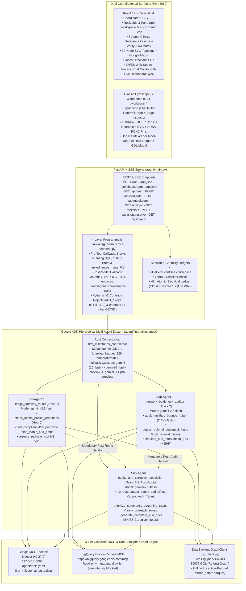

# First Milestones — Early Intervention & Developmental Screening Triage

**Agents for Impact 2026 · IDEA Part C 45-Day Multi-Hop Graph Triage & Network Audit Assistant**

[](agent/)
[](agent/first_milestones/agent.py)
[](scripts/setup_graph.sql)
[](frontend/)
[](data/README.md)

---

## Table of Contents

1. [Executive Summary & Headline Results](#1-executive-summary--headline-results)
2. [System Architecture & Multi-Agent Topology](#2-system-architecture--multi-agent-topology)
3. [Key Technical & Clinical Capabilities](#3-key-technical--clinical-capabilities)
4. [Quick Start & Local Usage Guide](#4-quick-start--local-usage-guide)
5. [BigQuery Data & Property Graph (`ReferralGraph`) Setup](#5-bigquery-data--property-graph-referralgraph-setup)
6. [Cloud Deployment (Cloud Run & Vertex AI Agent Engine)](#6-cloud-deployment-cloud-run--vertex-ai-agent-engine)
7. [REST, SSE & UI API Reference](#7-rest-sse--ui-api-reference)
8. [Environment Variables & Configuration](#8-environment-variables--configuration)
9. [Testing, 20-Case Evaluation Harness & Demo Recorder](#9-testing-20-case-evaluation-harness--demo-recorder)
10. [Repository Structure](#10-repository-structure)
11. [Challenge Specification, Data Provenance & Team Runbook Reference](#11-challenge-specification-data-provenance--team-runbook-reference)

---

## 1. Executive Summary & Headline Results

Under **Part C of the Individuals with Disabilities Education Act (IDEA, `34 CFR § 303.310`)**, states have a strict **45-calendar-day federal statutory clock** from the day an infant or toddler (`0–35` months) is referred for a developmental concern to deliver a multidisciplinary evaluation and an initial **Individualized Family Service Plan (IFSP)**—before Part C eligibility terminates at the **36-month aging-out cliff (`34 CFR § 303.209`)**.

When regional coordinators sort a flat SQL table by `active_waitlist_count DESC`, they blame downstream therapy clinics with long queues while missing the upstream **Bounce Hubs**: intake coordinators with healthy-looking `5`-day internal wait times whose `paper_fax` handoffs (`19.7d` average wait, `24.4%` drop-off per hop) fail to pre-check Medicaid vendor enrollment or Spanish bilingual slot capacity, triggering 3-to-4-hop re-referral cascades that blow past 70 days.

**First Milestones** combines a **BigQuery ISO/IEC 39075 Property Graph (`ReferralGraph`)**, a **hierarchical Google ADK multi-agent system** (`gemini-2.5-pro` coordinator + 3 specialist `gemini-2.5-flash` sub-agents), **Google-managed MCP servers** (MCP Toolbox for Databases + BigQuery Built-in Remote MCP), and a **dual-surface Coordinator Workbench** (React 19 + Google Maps + Voice/Chat Copilot at `/` and Classic Cytoscape.js + TIGER Choropleth Workbench at `/workbench`).

### Verified Ground-Truth Metrics Across All 6 Starter States

- **Multi-State Coverage (`a4i_early_intervention_multistate`):** **6 states** (`MS`, `AL` (`'01'`), `GA`, `TX`, `CA` (`'06'`), `NY`), **426** real US Census ACS tracts, **133,667** children under age 5, **180** `100% [Synthetic]` `CareNode` organizations (`30`/state), **894** directed `ReferralHandoff` edges (`149`/state) across **264** child referral chains (`44`/state: `35` chains of 3–4 hops and `26` breaching `>45` days per state), plus **727** public-domain **HRSA FQHC** community screening sites (`17 U.S.C. § 105`).
- **Track 1 — Active Child Triage (`CHAIN-MS-023`, 32m Autism Referral in Sunflower County, MS `28133950300`):**
  - **Historical 4-Hop `paper_fax` Cascade:** `SYN-PROV-MS-007 -> SYN-PROV-MS-011 -> SYN-PROV-MS-015 -> SYN-PROV-MS-019 -> SYN-PROV-MS-028` consumed **75 cumulative days** (`+30d` statutory breach), delivering therapy at `34.5` months (just 6 weeks before the 36-month Part C cliff).
  - **Prospective 3-Hop Electronic Route:** `SYN-PROV-MS-007 -> SYN-PROV-MS-011 -> SYN-PROV-MS-019 -> SYN-PROV-MS-028` via `ehr_electronic_portal` clears in **34 cumulative days** (**`-41 days` faster**, `+11d` safety buffer under the 45-day ceiling), locks capacity via a **48-hour atomic slot hold**, triggers **Medicaid NEMT / Natural Environment (`34 CFR § 303.126`)** transport support, and generates plain-language **English & Español** caregiver action notes.
- **Track 2 — Regional Network Bottleneck Audit & Counterfactual Simulation:**
  - Flat SQL sorting blames `SYN-PROV-MS-016` (`81` waitlist, `39d` wait) and `SYN-PROV-MS-025` (`80` waitlist, `38d` wait).
  - Prefix-deduplicated variable-length ISO GQL (`-{2,4}->`) exposes Indianola intake coordinator **`SYN-PROV-MS-011`** (`5d` internal wait, `24` waitlist) as the **#1 Hidden Bounce Hub**: **7 / 11 (`63.6%`)** of its routed episodes breach 45 days (`56.8d` mean wait, `198` excess days over 45).
  - **Counterfactual Single-Hub Fix:** Upgrading `SYN-PROV-MS-011` from `paper_fax` to `ehr_electronic_portal` + bilingual/Medicaid slot pre-check cuts its breaches from **`7 -> 2` (`-71%`)**, drops mean chain wait from **`56.8d -> 36.0d`**, reduces `CHAIN-MS-023` from **`75d -> 38d`**, and saves **229 delayed child-days** (in California `'06...'`, upgrading `SYN-PROV-CA-011` eliminates **7 / 7 breaches** and saves **223 child-days**).
- **Track 3 — Community Screening Outreach & Post-Output Equity Audit:**
  - Identifies **21 True Care-Delivery Hidden EI Deserts** in Mississippi—tracts within `25.0 km` of a clinic on a flat map that have **`0` reachable `<=45`-day uncongested Medicaid + bilingual pathways** (e.g., Bolivar County `28011950100` at `2.1 km` from a clinic with `0` compliant pathways; `28011950200` at `1.3 km`; Sunflower County `28133950100` at `1.4 km`)—and pairs them with real public-domain **HRSA FQHC** mobile screening host sites.
  - Enforces **zero routing weight (`0.0`)** on `audit_*` race/ethnicity columns during path selection, then joins `audit_*` post-output to quantify baseline vs. post-rerouting disparity reductions (`26 -> 0` breached episodes across high-poverty and zero-vehicle cohorts).

> [!IMPORTANT]
> **100% `[Synthetic]` Provider & Referral Ethics Notice:** Every provider node (`SYN-PROV-*`), regional Part C agency (`SYN-PARTC-*`), and referral log (`CHAIN-*`, `REF-*`) is **100% `[Synthetic]`** by design so fabricated waitlists, `paper_fax` bottlenecks, or 45-day statutory violations are never attributed to real clinicians. Under-5 neighborhood demographics (`acs_under5_tract_demographics`) are real public US Census ACS 5-Year data, `nsch_developmental_screening_survey` is modeled at `'Statewide'` grain (`6` strata/state) calibrated to HRSA NSCH NPM-6 totals, and `byod_hrsa_fqhc_screening_sites` is a real US Government public-domain work (`17 U.S.C. § 105`).

---

## 2. System Architecture & Multi-Agent Topology



### Multi-Agent Responsibilities (`agent/first_milestones/agent.py`)

| Agent Name | Default Model | Track & Role | Primary Tools |
|---|---|---|---|
| `first_milestones_coordinator` | `gemini-2.5-pro` (`thinking_budget=128`) | Root Orchestrator & Statutory Compliance Gatekeeper | Delegates to specialist sub-agents + holds 11 granular tools (`SHARED_TOOLS`) and governed MCP toolsets |
| `triage_pathway_router` | `gemini-2.5-flash` (`thinking_budget=0`) | **Track 1:** Active Child Referral Routing, Hop-0 Packet Readiness & 48h Slot Reservation | `check_intake_packet_readiness`, `find_compliant_45d_pathways`, `find_viable_45d_paths`, `reserve_pathway_slot`, `lookup_tract_routing_context`, `lookup_carenode_directory` |
| `network_bottleneck_auditor` | `gemini-2.5-flash` (`thinking_budget=0`) | **Track 2:** Correlated `-{2,4}->` ISO GQL Bounce Hub Diagnosis & Counterfactual Simulator | `get_referral_history`, `audit_multihop_bounce_hubs`, `detect_regional_bottleneck_hubs`, `simulate_hub_intervention`, `lookup_regional_agency_kpis`, `lookup_carenode_directory` |
| `equity_and_caregiver_specialist` | `gemini-2.5-flash` (`thinking_budget=0`) | **Track 3 & Post-Output Audit:** Neighborhood Disparity Audit, Hidden EI Deserts + HRSA FQHC Overlay & Bilingual EN/ES Caregiver Briefs | `run_post_output_equity_audit`, `prioritize_community_screening_tracts`, `rank_outreach_zones`, `generate_complete_45d_brief`, `lookup_statewide_nsch_strata`, `lookup_tract_routing_context` |

---

## 3. Key Technical & Clinical Capabilities

1. **Dual-Backend BigQuery ISO/IEC 39075 GQL Property Graph (`DualBackendGraphClient` in `agent/first_milestones/tools/bq_client.py`):**
   - Queries `<PROJECT>.<DATASET>.ReferralGraph` over two node labels (`CareNode`, `Neighborhood`) and four directed edge labels (`ReferralHandoff`, `REFERS_TO`, `CAN_REFER_TO`, `SERVES_AREA`).
   - Distinguishes historical transaction logs (`REFERS_TO`) from prospective capability corridors (`CAN_REFER_TO`) so an upstream clinic never routes into a congested (`congestion_ratio > 1.0`) or non-enrolled provider.
   - Correlates `case_chain_id` across variable-length hops (`(SELECT COUNT(DISTINCT h.case_chain_id) FROM UNNEST(hops) AS h) = 1`) and deduplicates 3-hop Type B intermediate prefix sub-paths (`QUALIFY ROW_NUMBER() OVER (PARTITION BY chain_id ORDER BY total_hops DESC) = 1`).
   - Automatically falls back to the local GeoParquet mirror (`data/*.parquet`) with 100% metric parity when running offline or with `A4I_FORCE_LOCAL_PARQUET=1`.
2. **Hop-0 Referral Packet Readiness Gatekeeper (`agent/first_milestones/tools/packet_gatekeeper.py`, `POST /api/gatekeeper`):**
   - Prevents the #1 real-world cause of 30–40 day `paper_fax` bounce loops before Hop 1 is transmitted by scoring Day-0 intake readiness (`0–100`): signed parental consent (`34 CFR § 303.420`), standardized developmental screening attachment (`ASQ-3`, `M-CHAT-R/F`, `SWYC`), Medicaid/insurance verification, interpreter requirement (`34 CFR § 303.321`), and 11-character tract verification.
3. **5-Tier `34 CFR § 303.209` / `§ 303.21` Statutory Age-3 Transition Engine (`classify_part_c_age_tier` in `graph_routing.py`):**
   - `0–26m`: Standard IDEA Part C timeline (`<=45` calendar days).
   - `27–32m`: Early transition planning window (`34 CFR § 303.209(d)`).
   - `33.0–34.4m`: Mandatory Local Educational Agency (LEA) Part B transition conference window (`>=90` days before 3rd birthday, `34 CFR § 303.209(b)-(c)`).
   - `34.5–35.9m`: Late referral `<45` days before age 3 (`34 CFR § 303.209(b)(1)(iii)` exemption + immediate dual Part C / LEA Part B Preschool Section 619 handoff).
   - `>=36m`: Hard statutory Part C aging-out cutoff (`status="ineligible_part_c_aged_out"`), immediately redirecting to IDEA Part B Section 619 (`34 CFR § 300.800`).
4. **Concurrency-Safe 48-Hour Transactional Slot Hold Ledger (`slot_ledger.py`, `GET /api/slots`, `POST /api/slots/reserve`):**
   - Atomically locks pathway capacity across `Coordinator`, `Eval Hub`, and `Vendor` CareNodes (`active_waitlist_count + active_holds_count + 1 <= monthly_slot_capacity`) so two coordinators never double-book the last bilingual evaluator slot.
   - Backed by **Cloud Firestore** (`@firestore.transactional` when `A4I_SLOT_LEDGER_BACKEND=firestore`) or thread-safe **SQLite WAL** (`BEGIN IMMEDIATE`, default `agent/.runtime/slot_ledger.db`), feeding directly into `graph_routing.py` congestion pruning.
5. **3-Tier Governed Google-Managed MCP Integration (`mcp_integration.py` + `agent/tools.yaml`):**
   - **Tier 1 — Google MCP Toolbox for Databases (`googleapis/mcp-toolbox` v0.27.0):** Runs as a sidecar on `127.0.0.1:5000` inside the Cloud Run container, exposing governed BigQuery SQL tools (`mcp_get_regional_agency_performance`, `mcp_get_statewide_nsch_screening_strata`, `mcp_lookup_tract_routing_context`, `mcp_list_carenode_directory`) via ADK `ToolboxToolset`.
   - **Tier 2 — BigQuery Built-in Remote Managed MCP Server (`https://bigquery.googleapis.com/mcp`):** Connected via ADK `McpToolset` + `StreamableHTTPConnectionParams` with strict `BQ_MCP_READONLY_TOOL_ALLOWLIST = ("list_dataset_ids", "get_dataset_info", "list_table_ids", "get_table_info")` (`execute_sql` explicitly blocked so the model cannot bypass the `audit_*` or `limited_english_rate` firewall).
   - **Tier 3 — Local GeoParquet Parity Lookups (`reference_lookups.py`):** Seamless offline fallback.
6. **4-Layer Anti-Bias & Data Trap Firewall (`guardrails.py`, `schemas.py`):**
   - Preserves leading-zero strings on `census_tract_geoid` (11 chars) and `county_fips` (5 chars) for Alabama (`'01...'`) and California (`'06...'`).
   - Programmatically blocks any SQL or tool filter/sort/weight on the all-zero ACS `limited_english_rate = 0.0` column (`GUARDRAIL_BLOCKED_LEP_ZERO_TRAP`) or `audit_*` race/ethnicity columns (`GUARDRAIL_BLOCKED_AUDIT_SORT_OR_FILTER`).
   - Enforces `'Statewide'` grain on HRSA NSCH (`6` rows/state, preventing 6× tract fan-out).
   - Verifies every cited `SYN-PROV-*` ID against state directories post-generation and guarantees clinical diagnosis refusal when diagnosis intent is detected.

---

## 4. Quick Start & Local Usage Guide

### Prerequisites

- **Python 3.12+** (with [`uv`](https://docs.astral.sh/uv/) or `.venv`)
- **Node.js 20+ & npm** (only required if rebuilding `frontend/`; pre-built assets and the classic workbench are ready out of the box)
- **Optional for Live BigQuery & Vertex AI Gemini:** Google Cloud SDK (`gcloud`) authenticated to a GCP project (`gcloud auth login`)

### Option A: Zero-Config Local Run (Works Offline or Live in 10 Seconds)

The server runs out of the box using the pre-staged 6-state GeoParquet mirror in `data/*.parquet` and automatically upgrades to live BigQuery ISO GQL + Vertex AI Gemini when GCP credentials are present:

```bash
# 1. (Optional) Bridge your active `gcloud auth login` session to BigQuery + Vertex AI Gemini:
source scripts/setup_local_adc.sh

# 2. Start the unified FastAPI + Coordinator Workbench server on http://localhost:8080:
PYTHONPATH=agent uv run --python 3.12 --with-requirements agent/requirements.txt \
  python agent/main.py
# Or using an existing .venv:
.venv/bin/python agent/main.py
```

Open in your browser:
- **`http://localhost:8080/`** — **React 19 + Tailwind v4 Coordinator UI** (3-pane resizable split workspace, 5-Agent Council, 30-node SVG topology, Google Maps clinic routing, EN/ES Voice & Chat Copilot).
- **`http://localhost:8080/workbench`** — **Classic Cytoscape.js Coordinator Workbench** (Cytoscape.js multi-hop graph, TIGER Census SVG choropleth with HRSA FQHC pins, Hop-0 Packet Gatekeeper, 48h Slot Hold Ledger, ISO GQL Inspector).
- **`http://localhost:8080/api/health`** — Live health, active model cascade, MCP mode, BigQuery job telemetry, and P50/P95 latency metrics.

### Option B: Launch the Built-in Google ADK Developer Web UI (`adk web`)

```bash
PYTHONPATH=agent uv run --python 3.12 --with-requirements agent/requirements.txt \
  adk web agent
```

### Option C: Develop or Rebuild the React Frontend (`frontend/`)

```bash
cd frontend
npm install                # Install React 19, Vite 6, Tailwind v4, Motion, Hyparquet
npm run extract-data       # Extract ../data/*.parquet into src/data/starterData.json (preserves '01'/'06' leading zeros)
npm run dev                # Start Vite dev server at http://localhost:5173
npm run build              # Build production bundle into frontend/dist/ (served by agent/main.py at GET /)
```

Optional frontend environment variables (or configure live at runtime via the **Connect ADK** modal in the top navigation bar):
- `VITE_AGENT_API_URL=/api/chat` (default in unified Docker/Cloud Run builds; or set to `http://localhost:8080/api/chat` during `npm run dev`)
- `VITE_GOOGLE_MAPS_API_KEY=<your-key>` (enables interactive Google Maps JavaScript + Places SDK vector pins and geodesic polylines; automatically falls back to a zero-key Google Maps coordinate embed + multi-waypoint Turn-by-Turn Directions link if omitted)

### Option D: Run the Unified Multi-Stage Docker Container Locally

The root `Dockerfile` compiles the React frontend (`node:20-slim`), installs the official Google MCP Toolbox for Databases binary (`v0.27.0`), bundles `data/*.parquet` and `agent/`, starts the `toolbox` sidecar on `127.0.0.1:5000`, and serves `uvicorn` on port `8080`:

```bash
docker build -t first-milestones-workbench .
docker run --rm -p 8080:8080 \
  -e GOOGLE_CLOUD_PROJECT="$(gcloud config get-value project)" \
  -e GOOGLE_GENAI_USE_VERTEXAI=TRUE \
  -e A4I_STATE=MS \
  first-milestones-workbench
```

---

## 5. BigQuery Data & Property Graph (`ReferralGraph`) Setup

### 1. Provision All 6 Starter States (`a4i_early_intervention_multistate`)

To load all 6 states (`MS`, `AL`, `GA`, `TX`, `CA`, `NY`) into `a4i_early_intervention_multistate` and create `ReferralGraph` without overwriting the shared single-state `a4i_early_intervention` dataset:

```bash
bash scripts/load_multistate.sh
```

### 2. Provision a Single State + `ReferralGraph` (`a4i_early_intervention`)

```bash
# Load tables + provision a4i-graph Enterprise reservation (0 baseline slots, autoscale to 50):
bash scripts/load.sh MS                 # or AL, GA, TX, CA, NY, ALL
bash scripts/load.sh --list             # list all pre-staged states

# Or run table load + ReferralGraph DDL + ISO GQL verification in one command:
bash scripts/setup_graph.sh MS          # or CA, AL, GA, TX, NY
bash scripts/setup_graph.sh --graph-only
```

### 3. Interactive Notebooks (`notebooks/`)

- **[`notebooks/c_ei_01_load_explore.ipynb`](notebooks/c_ei_01_load_explore.ipynb):** Provisions the `a4i-graph` Enterprise reservation (Section 1b), proves why flat SQL waitlist sorting fails (Section 2), exposes the all-zero `limited_english_rate` and 6× statewide NSCH grain traps (Sections 4–5), runs the post-output Equity Audit (Section 11), executes 28 automated `gate()` integrity checks (Section 12), and introduces BigQuery ISO GQL (Section 13).
- **[`notebooks/c_ei_02_graph_and_audit.ipynb`](notebooks/c_ei_02_graph_and_audit.ipynb):** Full companion deep-dive notebook covering `ReferralGraph` DDL (`CareNode`, `Neighborhood`, `ReferralHandoff`, `REFERS_TO`, `CAN_REFER_TO`, `SERVES_AREA`), prefix-safe `-{2,4}->` ISO GQL breach audits, `ANY SHORTEST` + `TO_JSON(p)` visualization, prospective `<=45`-day spatial routing, counterfactual single-hub simulations, and post-output cohort disparity audits.

### Example Prefix-Safe Variable-Length ISO/IEC 39075 GQL Query

```sql
SELECT
  chain_id,
  child_tract,
  total_hops,
  cumulative_wait_days,
  origin_clinic_id,
  coordinator_id,
  terminal_provider_id,
  first_channel,
  hop_path
FROM GRAPH_TABLE(
  `a4i_early_intervention_multistate.ReferralGraph`
  MATCH (src:CareNode WHERE src.state_code = 'MS')
        -[hops:REFERS_TO]->{2,4}
        (dst:CareNode WHERE dst.state_code = 'MS')
  WHERE hops[OFFSET(0)].hop_sequence = 1
    AND (SELECT COUNT(DISTINCT h.case_chain_id) FROM UNNEST(hops) AS h) = 1
  LET chain_id = hops[OFFSET(0)].case_chain_id,
      child_tract = hops[OFFSET(0)].child_home_tract_geoid,
      total_hops = ARRAY_LENGTH(hops),
      cumulative_wait_days = (SELECT SUM(h.handoff_wait_days) FROM UNNEST(hops) AS h),
      origin_clinic_id = src.provider_id,
      coordinator_id = hops[OFFSET(0)].target_provider_id,
      terminal_provider_id = dst.provider_id,
      first_channel = hops[OFFSET(0)].transmission_channel,
      hop_path = ARRAY_TO_STRING(
        ARRAY_CONCAT([src.provider_id], ARRAY(SELECT h.target_provider_id FROM UNNEST(hops) AS h)),
        ' -> '
      )
  FILTER cumulative_wait_days > 45
  RETURN chain_id, child_tract, total_hops, cumulative_wait_days,
         origin_clinic_id, coordinator_id, terminal_provider_id, first_channel, hop_path
)
QUALIFY ROW_NUMBER() OVER (PARTITION BY chain_id ORDER BY total_hops DESC) = 1
ORDER BY cumulative_wait_days DESC;
```

---

## 6. Cloud Deployment (Cloud Run & Vertex AI Agent Engine)

### Deploy Unified Workbench + MCP Toolbox Sidecar to Google Cloud Run

```bash
bash scripts/deploy_cloud_run.sh MS           # Provisions MS + ReferralGraph + deploys Cloud Run
bash scripts/deploy_cloud_run.sh CA           # Provisions CA + ReferralGraph + deploys Cloud Run
bash scripts/deploy_cloud_run.sh --skip-data  # Fast code-only redeploy using existing BigQuery dataset
```

What `scripts/deploy_cloud_run.sh` automates:
1. Enables required GCP APIs (`run`, `cloudbuild`, `artifactregistry`, `aiplatform`, `bigquery`, `bigqueryreservation`) and BigQuery Built-in Remote MCP (`gcloud beta services mcp enable bigquery.googleapis.com`).
2. Assigns least-privilege IAM roles to the Cloud Run service account (`roles/bigquery.dataViewer`, `roles/bigquery.jobUser`, `roles/aiplatform.user`, `roles/mcp.toolUser`, `roles/datastore.user`).
3. Deploys with `--min-instances=1` (zero cold starts), `--memory=2Gi`, `--cpu=2`, `A4I_GEMINI_MODEL=gemini-2.5-pro`, `A4I_SUBAGENT_MODEL=gemini-2.5-flash`, `A4I_DATASET=a4i_early_intervention`, and `A4I_MULTISTATE_DATASET=a4i_early_intervention_multistate`.

### Deploy ADK Agent Package to Vertex AI Agent Engine

```bash
# 1. Dry-run verification (checks adk CLI flags, staging bucket, and root_agent import):
bash scripts/deploy_agent_engine.sh --dry-run

# 2. Live deployment to Vertex AI Agent Engine:
bash scripts/deploy_agent_engine.sh --project="$GOOGLE_CLOUD_PROJECT" --region=us-central1
```

---

## 7. REST, SSE & UI API Reference

All endpoints are served by [`agent/main.py`](agent/main.py):

| Method & Path | Query / JSON Parameters | Description |
|---|---|---|
| `GET /` | None | Serves the built React 19 Coordinator UI (`frontend/dist/index.html`) or Classic Workbench if `A4I_CLASSIC_WORKBENCH=1`. |
| `GET /workbench` | None | Serves the Classic Cytoscape.js + TIGER SVG Choropleth Workbench (`agent/static/index.html`). |
| `GET /api/health` | None | Returns agent/sub-agent topology, active/fallback Gemini models, `mcp_mode`, active state/dataset, `bq_telemetry`, and P50/P95 latency metrics. |
| `GET /api/brief` | `state` (`MS`/`AL`/`GA`/`TX`/`CA`/`NY`), `tract_geoid` (11-char), `age_months` (`0..60`), `concern_domain`, `needs_medicaid` (`bool`), `needs_bilingual` (`bool`), `has_household_vehicle` (`bool`) | Computes and returns a Pydantic-validated `PathwayBrief` (Track 1 compliant pathways, Track 2 bounce hubs & counterfactual, Track 3 Hidden EI Deserts, Post-Output Equity Audit, and EN/ES Caregiver Notes). |
| `POST /api/chat` | JSON: `{"message": "...", "session_id": "...", "state_code": "MS"}` (also accepts `"prompt"`) | Synchronous multi-turn ADK `Runner` endpoint. Rejects any `audit_*` keys (`HTTP 422`). Returns `reply`, `response`, synchronized `brief`, `recommended_tab`, and `bq_telemetry`. |
| `POST /run`<br>`POST /run_sse`<br>`POST /api/chat/stream` | JSON: `{"message": "...", "session_id": "...", "state_code": "MS"}` or ADK `{"new_message": {"parts": [{"text": "..."}]}}` | Real-time Server-Sent Events (`text/event-stream`) emitting `agent_start`, `sub_agent`, `tool_call`, `tool_result`, `token`, `brief`, and `done`. |
| `POST /api/simulate` | JSON: `{"state_code": "MS", "target_provider_id": "SYN-PROV-MS-011", "upgrade_fax_to_ehr": true, "precheck_bilingual_and_slot_capacity": true}` | Runs counterfactual Bounce Hub simulation (`simulate_hub_intervention`) quantifying breaches eliminated and child-days saved. |
| `POST /api/gatekeeper` | JSON: `{"state_code": "MS", "tract_geoid": "28133950300", "child_age_months": 32, "consent_signed": true, "screening_tool_completed": true, "primary_language": "Spanish", "needs_medicaid": true, "has_household_vehicle": false}` | Validates Hop-0 IDEA Part C intake packet readiness (`34 CFR § 303.420` consent, screening tool, 5-tier `34 CFR § 303.209` transition ladder). |
| `GET /api/geo` | `state` (`MS`, `AL`, `GA`, `TX`, `CA`, `NY`) | Decodes Census TIGER WKB geometries into a `1000x640` SVG viewport alongside `SYN-PROV-*` CareNodes and public-domain HRSA FQHC BYOD sites. |
| `GET /api/slots` | `state` (`MS`, `AL`, `GA`, `TX`, `CA`, `NY`) | Lists active 48-hour pathway slot holds and per-provider capacity utilization (`monthly_slot_capacity`, `active_waitlist_count`, `active_holds_count`, `available_slots`). |
| `POST /api/slots/reserve` | JSON: `{"state_code": "MS", "coordinator_id": "SYN-PROV-MS-011", "eval_hub_id": "SYN-PROV-MS-019", "vendor_id": "SYN-PROV-MS-028", "child_tract_geoid": "28133950300", "hold_hours": 48}` | Atomically reserves a 48-hour pathway slot hold across specified CareNodes in Cloud Firestore or SQLite WAL. |

### Example `curl` Commands

```bash
# 1. Fetch a complete 45-Day Pathway & Bottleneck Brief for a 32-month toddler in MS:
curl -s "http://localhost:8080/api/brief?state=MS&tract_geoid=28133950300&age_months=32&concern_domain=autism_evaluation&needs_medicaid=true&needs_bilingual=true&has_household_vehicle=false" | jq .

# 2. Simulate upgrading Coordinator SYN-PROV-MS-011 from paper_fax to ehr_electronic_portal:
curl -s -X POST "http://localhost:8080/api/simulate" \
  -H "Content-Type: application/json" \
  -d '{"state_code":"MS","target_provider_id":"SYN-PROV-MS-011","upgrade_fax_to_ehr":true,"precheck_bilingual_and_slot_capacity":true}' | jq .

# 3. Validate Hop-0 intake packet readiness:
curl -s -X POST "http://localhost:8080/api/gatekeeper" \
  -H "Content-Type: application/json" \
  -d '{"state_code":"MS","tract_geoid":"28133950300","child_age_months":34,"consent_signed":true,"screening_tool_completed":false,"primary_language":"Spanish","needs_medicaid":true,"has_household_vehicle":false}' | jq .
```

---

## 8. Environment Variables & Configuration

| Variable | Default | Description |
|---|---|---|
| `GOOGLE_CLOUD_PROJECT` | Auto-detected via ADC / `gcloud` | Google Cloud project ID hosting BigQuery and Vertex AI. |
| `GOOGLE_CLOUD_LOCATION` | `"global"` (`"us-central1"` via `setup_local_adc.sh`) | Vertex AI endpoint region. |
| `GOOGLE_GENAI_USE_VERTEXAI` | `"TRUE"` in Cloud Run | Uses Vertex AI Gemini endpoints when `TRUE`/`1`; otherwise accepts `GOOGLE_API_KEY` / `GEMINI_API_KEY`. |
| `A4I_USE_GCLOUD_AUTH` | `"0"` | Set to `"1"` to bridge `gcloud auth print-access-token` credentials when local ADC JSON is absent. |
| `A4I_STATE` | `"MS"` | Default starter state (`MS`, `AL`, `GA`, `TX`, `CA`, `NY`). |
| `A4I_DATASET` | `"a4i_early_intervention"` | Primary single-state BigQuery dataset name. |
| `A4I_MULTISTATE_DATASET` | `"a4i_early_intervention_multistate"` | Multi-state BigQuery dataset containing all 6 states and `ReferralGraph`. |
| `A4I_LOCATION` | `"US"` | BigQuery dataset and reservation location. |
| `A4I_FORCE_LOCAL_PARQUET` | `"0"` | Set to `"1"` to force 100% offline execution against `data/*.parquet`. |
| `A4I_GEMINI_MODEL` | `"gemini-2.5-pro"` | Primary model for `first_milestones_coordinator`. |
| `A4I_GEMINI_FALLBACK_MODELS` | `"gemini-2.5-flash,gemini-3-flash-preview,gemini-3.1-pro-preview"` | Automatic fallback cascade on quota/preview errors. |
| `A4I_SUBAGENT_MODEL` | `"gemini-2.5-flash"` | Model for the 3 specialist sub-agents. |
| `A4I_MCP_MODE` | `"auto"` | MCP selection mode: `auto` \| `toolbox` \| `bigquery_mcp` \| `fallback`. |
| `TOOLBOX_URL` | `"http://127.0.0.1:5000"` | URL of the Google MCP Toolbox for Databases sidecar. |
| `A4I_SESSION_BACKEND` | `"sqlite"` | ADK session store: `sqlite` (`SqlitePersistentSessionService`), `memory`, or `vertex` (`VertexAiSessionService`). |
| `A4I_SESSION_DB_PATH` | `"/tmp/first_milestones_sessions.db"` | SQLite database file path for persistent multi-turn sessions. |
| `A4I_SLOT_LEDGER_BACKEND` | `"sqlite"` | 48-hour capacity hold ledger backend: `sqlite` (WAL) or `firestore` (`@firestore.transactional`). |
| `A4I_CLASSIC_WORKBENCH` | `"0"` | Set to `"1"` to serve the Classic Cytoscape.js Workbench (`agent/static/index.html`) at `GET /`. |
| `A4I_REQUIRE_AUTH` | `"0"` | Set to `"1"` to require `Authorization: Bearer <A4I_AUTH_BEARER_TOKEN>` on chat/brief/simulate endpoints. |
| `A4I_AUTH_BEARER_TOKEN` | `""` | Constant-time verified Bearer token when `A4I_REQUIRE_AUTH=1`. |
| `VITE_AGENT_API_URL` | `"/api/chat"` (Docker build) | Frontend default ADK chat endpoint URL. |
| `VITE_GOOGLE_MAPS_API_KEY` | `""` (zero-key fallback active) | Optional Google Maps JavaScript + Places API key for vector clinic maps. |

---

## 9. Testing, 20-Case Evaluation Harness & Demo Recorder

### 1. Run the Full Unit & Integration Test Suite (`agent/tests/`)

The repository includes 10 comprehensive `pytest` modules covering multi-agent delegation, Pydantic schema contracts, SQL/PII/audit guardrails, Hop-0 gatekeeper, 48h slot holds, SSE streaming, Cytoscape/React UI rendering, multi-state BigQuery GQL, pitch deck layout, and deployment packaging:

```bash
PYTHONPATH=agent uv run --python 3.12 --with-requirements agent/requirements.txt \
  --with pytest --with pytest-asyncio --with httpx --with pyyaml \
  pytest -q agent/tests/test_first_milestones.py \
            agent/tests/test_eval_graders.py \
            agent/tests/test_accuracy_upgrades.py \
            agent/tests/test_p0_p1_fixes.py \
            agent/tests/test_multi_agent_and_schemas.py \
            agent/tests/test_six_bugs_and_roi_features.py \
            agent/tests/test_sse_and_cytoscape.py \
            agent/tests/test_multistate_bq_and_notebooks.py \
            agent/tests/test_deployment_and_presentation.py
```

### 2. Run the 20-Case Automated Agent Evaluation Suite (`agent/eval/`)

[`agent/eval/evaluate_agent.py`](agent/eval/evaluate_agent.py) evaluates 20 golden + adversarial prompts ([`agent/eval/golden_evalset.json`](agent/eval/golden_evalset.json)) across 5 categories (`track_1_routing`, `track_2_audit`, `track_3_outreach`, `adversarial_guardrails`, `state_and_edge_cases`) plus a 4-request parallel `MS` + `CA` concurrency isolation probe, scored by 5 automated graders in [`agent/eval/graders.py`](agent/eval/graders.py) (see [`agent/eval/EVAL_AND_PROD_READINESS.md`](agent/eval/EVAL_AND_PROD_READINESS.md)):

```bash
# Fast local in-process ASGI evaluation:
PYTHONPATH=agent uv run --python 3.12 --with-requirements agent/requirements.txt --with httpx \
  python agent/eval/evaluate_agent.py --target local-asgi --output /tmp/local_eval.json

# Live HTTP evaluation against a deployed Cloud Run service:
PYTHONPATH=agent uv run --python 3.12 --with-requirements agent/requirements.txt --with httpx \
  python agent/eval/evaluate_agent.py \
    --target live-http \
    --base-url https://YOUR-CLOUD-RUN-URL.a.run.app \
    --output /tmp/eval_live.json

# Export a standard Google ADK `.evalset.json` artifact:
PYTHONPATH=agent uv run --python 3.12 --with-requirements agent/requirements.txt --with httpx \
  python agent/eval/evaluate_agent.py --target local-asgi --adk-export /tmp/first_milestones.evalset.json
```

### 3. Regenerate the `<3:00` Narrated Demo Video (`scripts/record_demo_video.py`)

```bash
.venv/bin/python scripts/record_demo_video.py --output presentation/first_milestones_demo.mp4
```

---

## 10. Repository Structure

```text
├── README.md                                       Project overview, technical & usage guide, and challenge reference
├── Dockerfile                                      Multi-stage build: React 19 UI + MCP Toolbox v0.27.0 + Python 3.12 ADK server
├── agent/                                          Python ADK multi-agent backend, FastAPI server, and Classic Workbench
│   ├── README.md                                   Detailed agent architecture & backend runbook
│   ├── main.py                                     FastAPI REST, SSE (/run, /run_sse, /api/chat/stream), and UI server
│   ├── entrypoint.sh                               Container entrypoint launching MCP Toolbox sidecar + Uvicorn
│   ├── tools.yaml                                  Google MCP Toolbox for Databases toolset declaration (first_milestones_bq)
│   ├── requirements.txt / pyproject.toml           Python dependencies (google-adk==2.14.1, google-cloud-bigquery, fastapi, etc.)
│   ├── first_milestones/                           Core Python package
│   │   ├── agent.py                                Root orchestrator (first_milestones_coordinator) + 3 specialist sub-agents
│   │   ├── prompts.py                              Statutory IDEA Part C prompts & 5-tier 34 CFR § 303.209 instructions
│   │   ├── schemas.py                              Pydantic v2 contracts (PathwayBrief, zero-audit_* validators, 11-char GEOIDs)
│   │   ├── guardrails.py                           Pre-tool SQL/arg firewall & post-model SYN-PROV/36m/diagnosis guardrails
│   │   ├── mcp_integration.py                      3-tier MCP integration (MCP Toolbox, BigQuery Remote MCP, local fallback)
│   │   ├── session_store.py                        Thread-safe SQLite WAL persistent session service + Vertex AI session switch
│   │   ├── brief_builder.py                        Orchestrates Track 1/2/3 outputs & bilingual EN/ES Caregiver Action Notes
│   │   └── tools/                                  Custom ISO GQL, spatial, gatekeeper, slot ledger & equity tools
│   │       ├── bq_client.py                        DualBackendGraphClient (BigQuery ISO GQL + local GeoParquet fallback)
│   │       ├── graph_routing.py                    Prospective <=45d pathway router & 5-tier age-3 transition classifier
│   │       ├── graph_audit.py                      Prefix-deduplicated -{2,4}-> bounce hub auditor & counterfactual simulator
│   │       ├── equity_audit.py                     Post-output audit_* disparity audit, Hidden EI Deserts & BYOD HRSA overlay
│   │       ├── packet_gatekeeper.py                Hop-0 referral packet completeness & statutory transition gatekeeper
│   │       ├── slot_ledger.py                      Atomic 48-hour capacity hold ledger (Cloud Firestore / SQLite WAL)
│   │       └── reference_lookups.py                Governed BigQuery & GeoParquet reference table lookups
│   ├── static/                                     Classic Cytoscape.js + TIGER Census Choropleth Workbench (/workbench)
│   ├── eval/                                       20-case golden/adversarial benchmark, 5 graders & ADK EvalSet bridge
│   │   ├── EVAL_AND_PROD_READINESS.md              Evaluation methodology, before/after ablation metrics & production readiness
│   │   ├── golden_evalset.json                     20 multi-track & adversarial test cases across MS and CA
│   │   ├── graders.py                              5 deterministic graders (Trajectory, Faithfulness, Statutory, Ethics, Concurrency)
│   │   ├── evaluate_agent.py                       CLI runner for local-asgi and live-http evaluation
│   │   └── adk_bridge.py                           Standard Google ADK EvalSet exporter
│   └── tests/                                      10 pytest unit, integration, UI & deployment verification suites
├── frontend/                                       React 19 + TypeScript + Vite 6 + Tailwind v4 Coordinator UI (served at /)
│   ├── README.md                                   Frontend feature summary & local dev guide
│   ├── scripts/extract-data.mjs                    Build-time GeoParquet -> starterData.json extractor (preserves leading zeros)
│   └── src/                                        Resizable 3-pane workspace, 5-Agent Council, 30-node SVG graph, Google Maps & Voice Copilot
├── scripts/                                        Headless data loaders, ReferralGraph DDL, local ADC bridge & deploy scripts
│   ├── README.md                                   CLI documentation for all 7 scripts
│   ├── load.sh                                     Single-state (or ALL) BigQuery loader + a4i-graph Enterprise reservation
│   ├── setup_graph.sh / setup_graph.sql            Declares helper views + ReferralGraph DDL + ISO GQL smoke tests
│   ├── load_multistate.sh                          Provisions all 6 states + ReferralGraph in a4i_early_intervention_multistate
│   ├── setup_local_adc.sh                          Bridges local `gcloud auth login` session for BigQuery GQL & Vertex AI
│   ├── deploy_cloud_run.sh                         End-to-end Cloud Run deployment script (--min-instances=1)
│   ├── deploy_agent_engine.sh                      Vertex AI Agent Engine deployment script (--dry-run supported)
│   └── record_demo_video.py                        Automated Playwright + /usr/bin/say + ffmpeg narrated MP4 generator
├── notebooks/                                      Colab Enterprise & local Jupyter notebooks
│   ├── c_ei_01_load_explore.ipynb                  Step 1: Provision a4i-graph reservation, load, explore & validate (28 gates)
│   ├── c_ei_02_graph_and_audit.ipynb               Step 2: Full ReferralGraph DDL, prefix-safe ISO GQL, counterfactuals & Equity Audit
│   └── c_ei_90_publish_snapshot.ipynb              Maintainer snapshot publisher
├── data/                                           Pre-staged 6-state GeoParquet starter tables + public-domain BYOD HRSA FQHC sites
│   └── README.md                                   Full table dictionary, grain, provenance, and licensing documentation
└── presentation/                                   Submission artifacts & technical architecture brief
    ├── TECHNICAL_ARCHITECTURE_AND_CHANGES.md       Deep-dive architectural record, 6 ROI features & 6 bug fixes
    ├── PITCH_DECK.md / pitch_deck.html / .pdf      10-slide Medical Clean executive pitch deck (HTML, PDF, and Markdown)
    └── DEMO_SCRIPT_3MIN.md / first_milestones_demo.mp4  Narrated <=3-minute live demo script and H.264/AAC video
```

---

## 11. Challenge Specification, Data Provenance & Team Runbook Reference

<details open>
<summary><strong>Click to expand/collapse the full Agents for Impact 2026 Challenge Brief & Runbook</strong></summary>

### Why this one matters

Federal law gives states **forty-five calendar days** from the moment an infant or toddler is referred for a developmental concern to deliver an evaluation and an initial Individualized Family Service Plan (IFSP). Under Part C of the Individuals with Disabilities Education Act (IDEA), that clock exists because speech, motor, or autism intervention at twenty months changes a child's developmental trajectory far more than starting the same support in kindergarten.

Yet across rural and high-poverty regions, thousands of two-year-olds blow past day forty-five without ever seeing an evaluator. When regional coordinators inspect a flat provider spreadsheet, the problem hides in plain sight: a pediatric screening clinic refers a toddler to an intake hub whose internal wait time looks healthy (five days), which faxes the packet to a backlogged evaluation hub, which bounces the family a third time when Spanish-language or Medicaid credentials are missing. By hop three, seventy days have vanished.

This is a **multi-hop network routing and bottleneck problem under a federal statutory clock**. A flat SQL sort points at whichever downstream clinic has the longest waitlist today. Only traversing the referral graph exposes the low-wait intake hub whose paper-fax handoffs silently trigger multi-hop breaches across an entire region.

**Your job today is to build the triage and network-audit assistant that finds a <=45-day pathway for today's child and exposes the multi-hop bounce hubs breaking the clock.**

---

### Four things everybody should know

1. **Every provider, agency, and referral row is 100% `[Synthetic]` on purpose.** Under-five neighborhood counts (`acs_under5_tract_demographics`) are real US Census ACS data, and `nsch_developmental_screening_survey` is calibrated to statewide HRSA NSCH totals, while `pediatric_and_ei_provider_directory` (`SYN-PROV-*`), `idea_part_c_agency_performance` (`SYN-PARTC-*`), and `deidentified_part_c_referral_logs` use fictional organizations so fabricated waitlists or 45-day statutory violations are never attached to real clinicians. State this plainly in your deck and video.
2. **BigQuery Graph requires the zero-baseline Enterprise reservation (`a4i-graph`).** Both `notebooks/c_ei_01_load_explore.ipynb` (Section 1b) and `scripts/load.sh` create and assign this automatically (`0` baseline slots, autoscale to `50`). Do not skip it.
3. **Watch two planted data traps:** `limited_english_rate` in `acs_under5_tract_demographics` is `0.0` across this ACS extract (use `primary_home_language` and `bilingual_services_listed` instead), and `nsch_developmental_screening_survey` is strictly **statewide** (`6` strata per state, so joining on `state_code` alone duplicates tracts 6x).
4. **Correlate `case_chain_id` across variable-length graph hops.** In ISO GQL (`-{2,4}->`), always correlate `case_chain_id` across hops so Child A's inbound referral is not stitched to Child B's outbound referral through the same coordinator.

---

### The four things you're working with

| Term | What it means |
|---|---|
| **`CareNode`** | One organizational vertex in `pediatric_and_ei_provider_directory` (`Screening_Pediatric_Clinic`, `Part_C_Intake_Coordinator`, `Multidisciplinary_Eval_Hub`, or `EI_Therapy_Vendor`), carrying waitlists, internal wait days, Medicaid enrollment, and bilingual capability |
| **`ReferralHandoff`** | One directed edge in `deidentified_part_c_referral_logs`, linking `source_provider_id` to `target_provider_id` along a toddler's `case_chain_id` (`hop_sequence` 1 through 4, `transmission_channel`, `handoff_wait_days`) |
| **Bounce Hub** | An intermediary `CareNode` whose own internal wait looks modest in a flat table, yet whose `paper_fax` or mismatched handoffs repeatedly trigger 3-to-4-hop re-referral chains exceeding the 45-day federal IDEA Part C limit |
| **45-Day Pathway & Bottleneck Brief** | A traced multi-hop graph diagnosis paired with a compliant <=45-day provider sequence for an incoming child, the regional hub intervention that saves the most child-days, Equity Audit findings, and a caregiver action note |

---

### Three tracks, one architecture

Every team shares the same spine: one BigQuery Property Graph (`a4i_early_intervention.ReferralGraph`) declared in ISO GQL, variable-length `-{2,4}->` path traversals, census-tract neighborhood context, and an ADK triage agent. **What changes between tracks is the coordinator's question, not the graph.**

| Track | What arrives | Primary user action | What makes it hard |
|---|---|---|---|
| **Track 1: Today's toddler referral** | A 20-to-32-month-old from a specific census tract needs Medicaid-accepted, Spanish-bilingual speech/autism evaluation under the 45-day clock | Intake coordinator routing an active case | Avoiding routing through historically bouncing edges while respecting travel distance (`ST_DISTANCE`), Medicaid acceptance, and bilingual availability |
| **Track 2: This quarter's network audit** | Regional IDEA Part C quality lead investigating why 45-day timely IFSP compliance dropped below 60% | Fixing systemic re-referral bottlenecks (replacing `paper_fax` intake links or adding bilingual eval slots) | Distinguishing downstream queue symptoms (`active_waitlist_count = 75`) from upstream routing hubs that cause 3-to-4-hop re-referrals |
| **Track 3: This community screening season** | Early-childhood coalition placing mobile developmental screening days across underserved neighborhoods | Prioritizing under-5 high-poverty, zero-vehicle tracts with clear downstream <=45-day referral capacity | Screening toddlers without verifying a working <=45-day evaluation pathway creates waitlists rather than services |

---

### Pre-Staged States (`data/*.parquet`)

Every state below carries **30 synthetic `CareNode` organizations** and **149 directed `ReferralHandoff` edges** across **44 child referral chains** (`35` multi-hop chains of `3` to `4` hops, with `26` breaching the `45`-day federal limit), anchored to real US Census tracts:

| State | `FIPS` | Tracts | Children under 5 | Regional 45-day IFSP range | `CareNode`s | Referral chains (`3+` hops / `>45d`) |
|---|---|---:|---:|---|---:|---|
| **MS** *(default)* | `28` | 64 | 15,512 | `52.5%` to `65.8%` | 30 | 44 (`35` / `26`) |
| **AL** | `01` | 43 | 9,396 | `54.5%` to `71.6%` | 30 | 44 (`35` / `26`) |
| **GA** | `13` | 57 | 14,505 | `56.4%` to `70.7%` | 30 | 44 (`35` / `26`) |
| **TX** | `48` | 72 | 29,599 | `57.6%` to `70.9%` | 30 | 44 (`35` / `26`) |
| **CA** | `06` | 101 | 41,144 | `61.7%` to `74.9%` | 30 | 44 (`35` / `26`) |
| **NY** | `36` | 89 | 23,511 | `55.2%` to `58.3%` | 30 | 44 (`35` / `26`) |

---

### Dataset Inventory & Provenance Summary (`data/`)

| Table | Grain | Loaded rows (`MS` default) | 6-state pack total | Provenance summary |
|---|---|---:|---:|---|
| `acs_under5_tract_demographics` | 1 row / census tract | 64 | 426 | **Real public** US Census ACS under-5 counts, poverty, zero-vehicle, TIGER polygons & `audit_*` shares (`limited_english_rate` is `0.0`) |
| `nsch_developmental_screening_survey` | 1 row / state income-language stratum | 6 | 36 | **Modeled state-level only** (`geographic_level = 'Statewide'`), calibrated to HRSA NSCH NPM-6 totals |
| `idea_part_c_agency_performance` | 1 row / synthetic regional hub | 3 | 18 | **100% `[Synthetic]`** regional Part C lead agencies calibrated to OSEP 45-day IFSP state reports |
| `pediatric_and_ei_provider_directory` | 1 row / `CareNode` vertex | 30 | 180 | **100% `[Synthetic]`** clinics, coordinators, eval hubs & therapy vendors (`SYN-PROV-*`, zero real clinicians) |
| `deidentified_part_c_referral_logs` | 1 row / `ReferralHandoff` edge | 149 | 894 | **100% `[Synthetic]`** variable-length (`2` to `4` hop) referral & re-referral chains (`44` chains/state) |
| `byod_hrsa_fqhc_screening_sites` | 1 row / active HRSA FQHC site | 64 | 727 | **Real Public-Domain BYOD (`17 U.S.C. § 105`)** HRSA Health Center Service Delivery Sites for Track 3 community screening proximity |

---

### Bringing Your Own Data (BYOD) Licensing Rules

| Rule | Why |
|---|---|
| ❌ No **NonCommercial** (`CC BY-NC`) | Winning projects are promoted publicly |
| ❌ No **NoDerivatives** (`CC BY-ND`) | Derived tools and outputs are the goal |
| ❌ No **Share-Alike** (`ODbL`, `CC BY-SA`) | Encumbers your team's repository |
| ❌ No **individual-level personal data (PII)** or real clinician defamation | Never attach synthetic waitlists or statutory breaches to real individual providers |
| ❌ No **unstated license** | Unlicensed directories cannot be loaded |
| ✅ **Public domain, CC0, US Government works (`17 U.S.C. § 105`)** | Safe (e.g., `data/byod_hrsa_fqhc_screening_sites.parquet`) |

---

### Judging Rubric Alignment

| Dimension | Weight | How First Milestones Addresses It |
|---|---:|---|
| **Impact & insight** | 30 | Complete 45-Day Pathway & Bottleneck Brief with Hop-0 Packet Gatekeeper, 48h atomic slot reservation, counterfactual fax-to-EHR simulator (`229` child-days saved at `SYN-PROV-MS-011`), and bilingual EN/ES caregiver action notes |
| **Technical execution** | 30 | Hierarchical 4-agent ADK architecture (`gemini-2.5-pro` + 3 `gemini-2.5-flash` sub-agents), Google MCP Toolbox v0.27.0 sidecar + BigQuery Built-in Remote MCP, and prefix-deduplicated variable-length ISO GQL over `ReferralGraph` deployed on Cloud Run & Agent Engine |
| **Rigor & judgment** | 25 | 4-layer programmatic firewall catching `limited_english_rate = 0.0`, preserving 6-row `'Statewide'` NSCH grain, correlating `case_chain_id` across `-{2,4}->` hops, preserving `'01'`/`'06'` leading-zero GEOIDs, enforcing `0.0` `audit_*` routing weight, and running post-output cohort disparity audits |
| **Craft & communication** | 15 | Dual UI surfaces (React 19 + Google Maps + Voice/Chat Copilot at `/` and Cytoscape.js + TIGER Choropleth Workbench at `/workbench`), 10-slide Medical Clean Pitch Deck (`presentation/pitch_deck.html` & `.pdf`), and `<3:00` narrated live walkthrough (`presentation/first_milestones_demo.mp4`) |
| **Bonus: range** | **+10** | Counterfactual single-hub bottleneck simulator, 5-tier `34 CFR § 303.209` aging-out triage (`0–36m+`), and compliant US Government public-domain HRSA FQHC BYOD enrichment (`data/byod_hrsa_fqhc_screening_sites.parquet`) |

</details>
