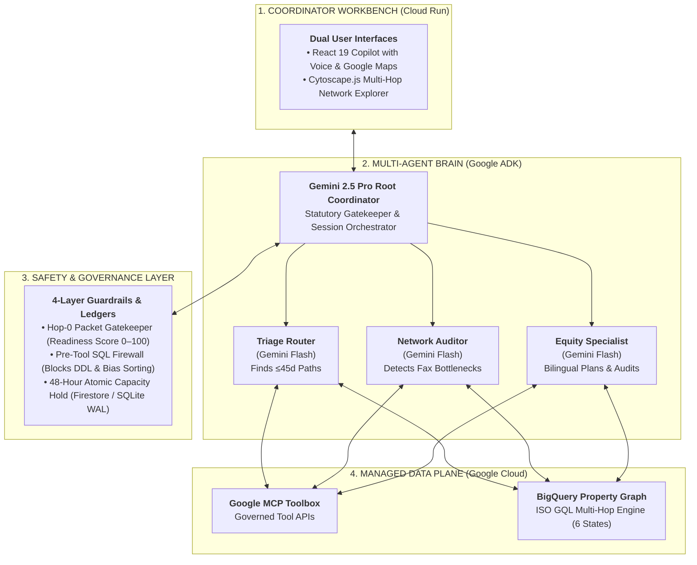
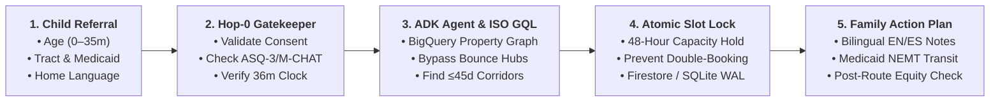

# First Milestones — Simple System Architecture & Workflow Blueprint

## 1. Simple System Architecture

### The 4 Simple Layers
1. **Coordinator Workbench (Cloud Run):** Unified web container serving a modern React 19 triage copilot with live voice interaction and Google Maps, alongside a classic Cytoscape.js network explorer.
2. **Multi-Agent Brain (Google ADK):** Gemini 2.5 Pro orchestrator managing three dedicated Gemini 2.5 Flash specialist agents for pathway routing, bottleneck audits, and bilingual caregiver communications.
3. **Safety & Governance Layer:** Programmatic firewall scoring intake packet readiness, preventing race conditions with a 48-hour atomic slot hold, and blocking ungrounded demographic bias in routing.
4. **Governed Data Plane (BigQuery & MCP):** Live BigQuery ISO/IEC 39075 Property Graph (`ReferralGraph`) running multi-hop traversals across 6 states, integrated via the Google Model Context Protocol (MCP) Toolbox.

---

## 2. Simple End-to-End Workflow Diagram

### 5 Workflow Steps
1. **Intake & Referral Arrival:** Coordinator enters child details (e.g., 32-month toddler in Sunflower County needing Medicaid Spanish autism evaluation).
2. **Hop-0 Packet Gatekeeper:** Automatically verifies required consents, screening attachments (ASQ-3/M-CHAT), and age tier before transmission to prevent Day-0 bounce loops.
3. **Property Graph Routing (ISO GQL):** Traverses live BigQuery `ReferralGraph` to bypass known paper-fax bottleneck hubs and identify verified $\le$45-day multidisciplinary evaluation corridors.
4. **48-Hour Atomic Slot Reservation:** Atomically locks capacity across the coordinator, eval hub, and therapy vendor so scarce bilingual slots aren't double-booked.
5. **Caregiver Note & Transit Support:** Delivers plain-language bilingual (English/Español) family action notes and automatically pre-authorizes Medicaid non-emergency medical transportation (NEMT) for zero-vehicle households.
