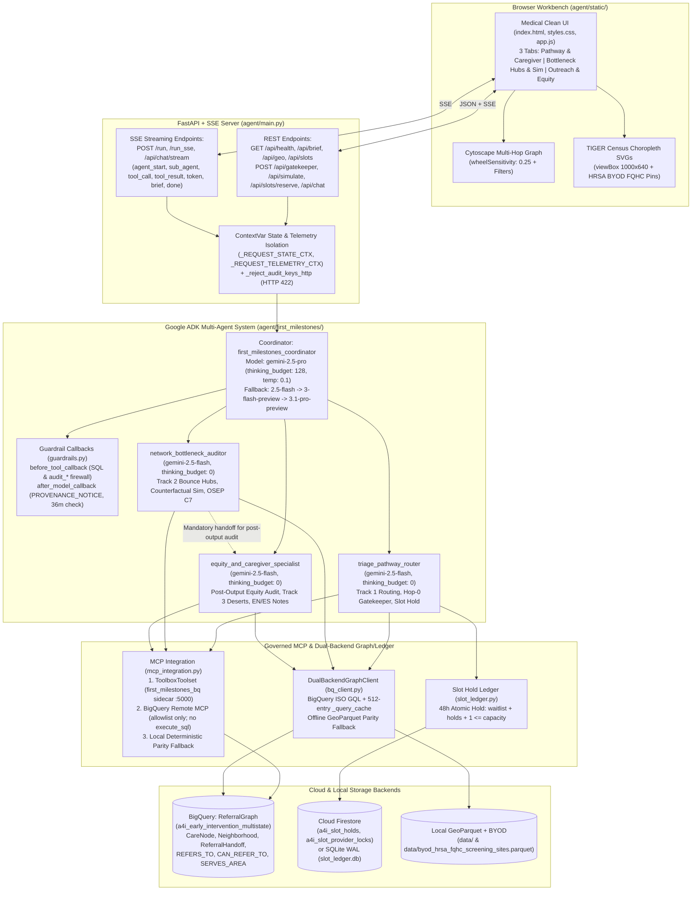

# First Milestones — Technical Architecture & Engineering Changelog

**Branch:** `feat/first-milestones-triage` (pushed through `ef548c2` + doc alignment, evolved from starter baseline `46b87a1`)  
**Scope:** Multi-agent IDEA Part C Early Intervention triage system built with Google ADK, Gemini 2.5 Pro/Flash, BigQuery Property Graph (ISO/IEC 39075 GQL), Managed MCP / MCP Toolbox, Cloud Firestore / SQLite WAL, and FastAPI + SSE Medical Clean Workbench.

---

## 1. Executive Summary

### What Changed on `feat/first-milestones-triage`
From starter commit `46b87a1` through `ef548c2` (11 commits across 62 modified/added files; `33,573 insertions(+)`, `1,783 deletions(-)`), the repository evolved from an exploratory starter scaffold into a production-deployed, multi-state IDEA Part C triage workbench (`agent/first_milestones/`, `agent/main.py`, `agent/static/`, `scripts/`, `agent/eval/`, `agent/tests/`). Existing earlier slide/video files (`PITCH_DECK.md`, `DEMO_SCRIPT_3MIN.md`, `pitch_deck.html`, `pitch_deck.pdf`, `first_milestones_demo.mp4`) were intentionally preserved untouched so pre-existing presentation verification gates remain green.

### Clinical & Policy Problem Solved
Under **IDEA Part C (`34 CFR § 303.310`)**, states must move a toddler (`0–35` months) from initial developmental referral to an evaluation and **Individualized Family Service Plan (IFSP)** within **45 calendar days**. Flat SQL waitlist sorting (`active_waitlist_count`) routinely misleads administrators by blaming downstream evaluation clinics while missing upstream **"Bounce Hubs"**—`Part_C_Intake_Coordinator` nodes with short internal waits (`5–6` days) whose `paper_fax` handoffs and unverified bilingual/Medicaid routing trigger `3`- to `4`-hop re-referral loops exceeding `45` days (for example, `26/44` = `59.1%` breached chains in `MS`, and `CHAIN-MS-023` taking `75` days before `34`-day electronic rerouting).

### Core Outcomes Verified in Repository Code & Data
- **Multi-State Property Graph Scale:** Unified `a4i_early_intervention_multistate` schema across **6 states** (`MS`, `AL`, `GA`, `TX`, `CA`, `NY`) covering **426** census tracts, **133,667** children under age 5, **180** `[Synthetic]` `CareNode` organizations, and **264** multi-hop referral chains (with `MS` at `40.9%` timely / `59.1%` breached, `CA` `'06...'` at `101` tracts / `41,144` under-5, and `AL` `'01...'` at `43` tracts / `9,396` under-5).
- **Counterfactual Intake Modernization Impact:** Upgrading `SYN-PROV-MS-011` (`paper_fax` -> `ehr_electronic_portal` + pre-verified bilingual/Medicaid slot capacity) eliminates `5/7` breaches and saves `229` delayed child-days; upgrading `SYN-PROV-CA-011` eliminates `7/7` breaches and saves `223` child-days (`presentation/PITCH_DECK.md`).
- **Strictly Post-Output Equity & Hidden EI Deserts:** Identifies **21** Hidden EI Deserts in `MS` (tracts within `25.0 km` of a clinic on a map that have `0` reachable `<=45`-day Medicaid/bilingual pathways, e.g., tract `28011950100` at `2.1 km` / `0` paths) while pairing them with real public-domain **HRSA FQHC** screening sites (`17 U.S.C. § 105`) and quantifying cohort `dropoff_rate_pct` reductions (`26 -> 0` breached episodes in `MS` under counterfactual rerouting) without ever feeding demographic `audit_*` shares into routing or ranking math.

---

## 2. System & Multi-Agent Architecture

### End-to-End Architecture

### Multi-Agent Topology & Model Configuration (`agent/first_milestones/agent.py`)
- **Coordinator (`first_milestones_coordinator` / `root_agent`):** Runs on `DEFAULT_MODEL = "gemini-2.5-pro"` (`temperature=0.1`, `top_p=0.9`, `thinking_budget=128` via `_build_generate_content_config`), with automated fallback ordering in `get_model_candidates()` across `["gemini-2.5-flash", "gemini-3-flash-preview", "gemini-3.1-pro-preview"]`.
- **Three Specialized Sub-Agents (`SUBAGENT_MODEL = "gemini-2.5-flash"`, `thinking_budget=0`):**
  1. `triage_pathway_router` (`create_triage_sub_agent`): Executes Track 1 compliant `<=45`-day routing (`find_compliant_45d_pathways`, `find_viable_45d_paths`), Hop-0 readiness (`check_intake_packet_readiness`), 48-hour slot reservations (`reserve_pathway_slot`), `lookup_tract_routing_context`, `lookup_carenode_directory`, and `generate_complete_45d_brief`.
  2. `network_bottleneck_auditor` (`create_audit_sub_agent`): Executes Track 2 audits (`audit_multihop_bounce_hubs`, `detect_regional_bottleneck_hubs`, `simulate_hub_intervention`, `get_referral_history`, `lookup_regional_agency_kpis`) and is instructed (`prompts.py`) to transfer to `equity_and_caregiver_specialist` upon completion so equity verification executes strictly post-output.
  3. `equity_and_caregiver_specialist` (`create_equity_sub_agent`): Executes `run_post_output_equity_audit`, `rank_outreach_zones`, `prioritize_community_screening_tracts`, `lookup_statewide_nsch_strata`, and `build_caregiver_notes`.
- **Managed MCP & Sidecar Integration (`mcp_integration.py`, `agent/tools.yaml`, `agent/entrypoint.sh`, `Dockerfile`):**
  - **Priority 1 — MCP Toolbox Sidecar:** `agent/entrypoint.sh` renders `agent/tools.yaml` (`${GOOGLE_CLOUD_PROJECT}`, `${A4I_LOCATION}`, `${A4I_DATASET}`) to `/tmp/tools.rendered.yaml` and starts the official `toolbox` v0.27.0 binary on `127.0.0.1:5000` exposing toolset `first_milestones_bq` (`mcp_get_regional_agency_performance`, `mcp_get_statewide_nsch_screening_strata`, `mcp_lookup_tract_routing_context`, `mcp_list_carenode_directory`), loaded via `ToolboxToolset`.
  - **Priority 2 — BigQuery Remote MCP:** `McpToolset` + `StreamableHTTPConnectionParams` against `https://bigquery.googleapis.com/mcp`, filtered by `filter_governed_bq_mcp_tools` to `BQ_MCP_READONLY_TOOL_ALLOWLIST = ("list_dataset_ids", "get_dataset_info", "list_table_ids", "get_table_info")` while stripping `FORBIDDEN_UNRESTRICTED_BQ_MCP_TOOLS = frozenset({"execute_sql"})`.
  - **Priority 3 — Local Parity Fallback:** Deterministic `reference_lookups.py` tools when running offline without Toolbox/MCP.

---

## 3. Top 6 High-ROI Features Built

| # | Feature | Behavior & Clinical/Policy Impact | Concrete Code Anchors |
| :--- | :--- | :--- | :--- |
| **1** | **Hop-0 Referral Packet Readiness Gatekeeper** | Prevents silent `30–40`-day `paper_fax` bounce rejections by scoring Day-0 prerequisites before transmission: `34 CFR § 303.420` parental consent (`-35` pts), `AAP Bright Futures / 34 CFR § 303.303` `ASQ-3 / SWYC` or `M-CHAT-R/F` screen (`-25` pts), `34 CFR § 303.520` insurance verification (`-15`/`-10` pts), `34 CFR § 303.126` tract verification (`-10` pts), `34 CFR § 303.321(a)(5)` interpreter check, and 5-tier age-3 cliff detection. Returns `READY_FOR_EHR_HANDOFF`, `CONDITIONAL_VERIFY_DETAILS`, `BLOCKED_MISSING_PREREQUISITES`, or `REDIRECT_TO_IDEA_PART_B_LEA`. | `agent/first_milestones/tools/packet_gatekeeper.py` (`check_intake_packet_readiness`), `agent/main.py` (`GatekeeperRequest`, `POST /api/gatekeeper`), `agent/static/app.js` (`verifyIntakePacket`) |
| **2** | **Before-vs-After Counterfactual Cohort SVI & Disparity Audit** | Quantifies how purely non-racial operational modernization (`paper_fax` -> `ehr_electronic_portal` + pre-verified Medicaid/bilingual corridors) improves equity without touching race in routing: reports `breached_episodes_before`, `breached_episodes_after`, `dropoff_reduction_pp`, and `post_output_demographic_parity` (`dropoff_rate_pct` reductions across Black, Hispanic, Indigenous, Asian, White, High Poverty `>=20%`, and Zero-Vehicle `>=10%` strata). | `agent/first_milestones/tools/equity_audit.py` (`_simulate_non_racial_rerouting_cohort`, `run_post_output_equity_audit`), `agent/first_milestones/schemas.py` (`EquityAuditResult`), `agent/static/index.html` (`#beforeAfterEquityCard`) |
| **3** | **Interactive Counterfactual Intake Workbench & TIGER Corridor Map** | Lets coordinators vary tract, developmental concern domain, child age (`0–42m` slider), Medicaid, Spanish/bilingual need, and household vehicle access to recompute `viable_45d_paths`, Cytoscape trajectories, and a `1000x640` TIGER Census tract corridor SVG map (`_wkb_parse_rings` + `_simplify_ring`). Includes cross-tab drilldowns (`routeHubInTab1Btn`, `viewEquityInTab3Btn`), Markdown export (`exportBriefMarkdown`), and print-ready audit CSS (`@media print`). | `agent/static/index.html`, `agent/static/app.js` (`loadBriefWithIntakeParams`, `renderTigerCorridorMap`, `exportBriefMarkdown`), `agent/static/styles.css` (`@media print`), `agent/main.py` (`_merge_captured_brief`, `_build_geo_payload`) |
| **4** | **Live Multi-Agent SSE Streaming & BigQuery ISO GQL Telemetry** | Streams `agent_start`, `sub_agent`, `tool_call`, `tool_result`, `token`, `brief`, and `done` SSE events from ADK runners with server-computed tab routing (`_compute_recommended_tab`). Attaches request-scoped BigQuery job IDs, latencies, and bytes processed—or explicitly labels offline runs as `Local Deterministic Parquet Graph`—in the UI telemetry bar and GQL modal. | `agent/main.py` (`_stream_adk_run_events`, `POST /run`, `POST /run_sse`, `POST /api/chat/stream`), `agent/first_milestones/tools/bq_client.py` (`record_bq_telemetry`, `get_bq_telemetry`, `reset_bq_telemetry`), `agent/static/app.js` (`streamRunSse`, `gqlTelemetryBar`) |
| **5** | **Dual-Backend 48-Hour Transactional Slot Hold Ledger** | Prevents double-booking thundering herds across coordinator, evaluation hub, and therapy vendor using atomic capacity enforcement (`active_waitlist_count + active_holds_count + 1 <= monthly_slot_capacity`). Uses `@firestore.transactional` over `a4i_slot_holds` and `a4i_slot_provider_locks` in Cloud Run (`A4I_SLOT_LEDGER_BACKEND=firestore`), or SQLite `PRAGMA journal_mode=WAL` + `BEGIN IMMEDIATE` locally. | `agent/first_milestones/tools/slot_ledger.py` (`reserve_pathway_slot`, `list_slot_holds`, `release_slot_hold`, `get_active_hold_counts`), `agent/main.py` (`SlotReserveRequest`, `GET /api/slots`, `POST /api/slots/reserve`), `agent/static/app.js` (`reserveRecommendedSlot`) |
| **6** | **Public-Domain HRSA FQHC BYOD Overlay & Clickable Hidden EI Desert Map** | Joins real public-domain HRSA FQHC screening sites (`data/byod_hrsa_fqhc_screening_sites.parquet`, cited under `17 U.S.C. § 105` via `BYOD_HRSA_PROVENANCE`) onto TIGER choropleth maps (`renderTigerDesertMap`). Highlights Hidden EI Deserts (`nearest_any_clinic_km <= 25.0 and reachable_45d_paths_count == 0`), attaches `byod_nearest_fqhc_km` / `byod_fqhc_site_name`, and enables one-click `"Route Toddler Here"` triage (`routeSelectedTractBtn`). | `agent/first_milestones/tools/reference_lookups.py` (`load_byod_hrsa_sites`, `BYOD_HRSA_PROVENANCE`), `agent/first_milestones/tools/equity_audit.py` (`rank_outreach_zones`, `prioritize_community_screening_tracts`), `agent/main.py` (`GET /api/geo`), `agent/static/app.js` (`renderTigerDesertMap`) |

---

## 4. Six Critical Rigor & Production Fixes Resolved

| # | Defect Identified (Before) | Resolution Implemented (After) | Verified File / Symbol Anchors |
| :--- | :--- | :--- | :--- |
| **1** | **Cloud Run MCP & Sidecar Boot Failure:** `tools.yaml` used invalid `${A4I_LOCATION:US}` syntax; `toolbox-adk` dependency was missing; Cloud Run service account lacked `roles/mcp.toolUser` & `roles/datastore.user`; unrestricted BigQuery MCP risked raw `execute_sql`. | Added `toolbox-adk>=0.5.0` & `toolbox-core>=0.5.0` to `requirements.txt`; normalized `${A4I_LOCATION}` / `${A4I_DATASET}` in `tools.yaml` with shell defaults in `entrypoint.sh`; granted `roles/mcp.toolUser` and `roles/datastore.user` in `deploy_cloud_run.sh`; enforced `BQ_MCP_READONLY_TOOL_ALLOWLIST` in `mcp_integration.py`. | `agent/requirements.txt`, `agent/tools.yaml`, `agent/entrypoint.sh`, `scripts/deploy_cloud_run.sh`, `agent/first_milestones/mcp_integration.py` (`filter_governed_bq_mcp_tools`) |
| **2** | **UI Table Header / Cell Mismatch:** `#bottleneckTable` and `#outreachZonesTable` had misaligned `<thead>` column counts vs. JavaScript row cell renderers, shifting clinical and desert metrics across wrong headers. | Aligned `index.html` table headers and `app.js` column renderers 1-to-1: `#bottleneckTable` strictly **6 columns** and `#outreachZonesTable` strictly **9 columns**, verified by regex HTML/JS tests. | `agent/static/index.html`, `agent/static/app.js`, `agent/tests/test_six_bugs_and_roi_features.py` (`test_bug2_ui_table_thead_matches_app_js_columns`) |
| **3** | **Rural `<= 80 km` Edge Starvation, Unfiltered Mid-Hops & Single-State Lock:** `v_graph_serves_area_edges` dropped edges `> 80,000 m`; GQL queries didn't check Medicaid/bilingual/bounce constraints on intermediate hops; `CA`/`AL` leading zeros risked stripping in single-state setups. | Removed `<= 80000` cutoff from `v_graph_serves_area_edges` (`COALESCE(sa.skm, ST_DISTANCE(...)/1000.0)` + `mobile_visit_capable`); added `(SELECT LOGICAL_AND(...) FROM UNNEST(h) e)` mid-hop filters in `_build_viable_45d_paths_gql`; provisioned all 6 states in `a4i_early_intervention_multistate` with zero-padded 11-digit `census_tract_geoid` and 5-digit `county_fips`. | `scripts/setup_graph.sql`, `scripts/load_multistate.sh`, `agent/first_milestones/tools/graph_routing.py` (`_build_viable_45d_paths_gql`), `agent/first_milestones/tools/bq_client.py` (`load_local_state_frames`, `resolve_dataset_for_state`) |
| **4** | **Global `A4I_STATE` Concurrency Race & Chat <-> Pane Split-Brain:** Concurrent requests mutating `os.environ["A4I_STATE"]` could cross-contaminate states; chat SSE runs could drop right-pane updates or overwrite Gemini bilingual caregiver notes. | Isolated active state and BigQuery telemetry in `ContextVar` (`_REQUEST_STATE_CTX`, `_REQUEST_TELEMETRY_CTX`) via `request_state_context()`; added `_merge_captured_brief()` to reconcile `viable_45d_paths` -> `routing` while preserving LLM-generated caregiver notes and returning server-driven `recommended_tab`. | `agent/first_milestones/tools/bq_client.py` (`request_state_context`), `agent/main.py` (`_merge_captured_brief`, `_compute_recommended_tab`), `agent/static/app.js` (`sendChatMessage`) |
| **5** | **`34 CFR § 303.209` Age-3 Cliff Math & `34 CFR § 303.126` Travel Conflation:** Coarse age thresholds misclassified `34.5–35.9m` (`<45d` before age 3) and `>=36m` Part B toddlers; Natural Environment home-visit vendor travel distance was conflated with family clinic driving distance. | Implemented 5-tier `classify_part_c_age_tier` (`0-26m`, `27-32m`, `33.0-34.4m`, `34.5-35.9m` `tier_4_less_than_45d_exemption_dual_handoff_34_5_35_9m` under `34 CFR § 303.209(b)(1)(iii)`, and `>=36m` `tier_5_part_b_section_619_lea_direct_36m_plus` under `34 CFR § 303.21` / `§ 300.800`); separated `family_clinic_travel_km` from `home_visit_vendor_distance_km`. | `agent/first_milestones/tools/graph_routing.py` (`classify_part_c_age_tier`, `_evaluate_candidate_corridors`, `find_compliant_45d_pathways`), `agent/first_milestones/brief_builder.py` (`_compute_statutory_transition_tier`) |
| **6** | **Caregiver EN/ES Static/Jargon Leaks & Missing Equity Delta:** Notes emitted unanchored `Day +X` placeholders, leaked `[Synthetic]` into caregiver copy, mixed English domain terms into Spanish output, and lacked before/after equity deltas. | Anchored deadlines to calendar `YYYY-MM-DD` dates (`age_3_cutoff_date`, 45-day deadline); added `_localize_domain_es()` (e.g., `"habla y lenguaje expresivo"`); isolated `[Synthetic]` notices to the demo footer via `_clean_provider_name()`; branched Medicaid vs. commercial/sliding-scale text; added `before_vs_after_rerouting_cohort`. | `agent/first_milestones/brief_builder.py` (`build_caregiver_notes`, `_clean_provider_name`, `_localize_domain_es`), `agent/first_milestones/tools/equity_audit.py` (`_simulate_non_racial_rerouting_cohort`) |

---

## 5. Multi-State Data, ISO GQL & Guardrail Engineering

### BigQuery Tables, Views & `ReferralGraph` Property Graph
Provisioned in `a4i_early_intervention` (single-state default) and `a4i_early_intervention_multistate` (`MS`, `AL`, `GA`, `TX`, `CA`, `NY`) via `scripts/setup_graph.sql` and `scripts/load_multistate.sh`:
- **5 Core Tables:**
  1. `acs_under5_tract_demographics` (real US Census ACS 5-year tract indicators; zero-padded 11-char `census_tract_geoid`)
  2. `nsch_developmental_screening_survey` (HRSA NSCH survey strictly at `Statewide` grain—6 rows per state)
  3. `idea_part_c_agency_performance` (`[Synthetic]` `SYN-PARTC-*` OSEP Indicator C7 regional lead agency performance)
  4. `pediatric_and_ei_provider_directory` (`[Synthetic]` `SYN-PROV-*` 30 `CareNode` organizations per state)
  5. `deidentified_part_c_referral_logs` (`[Synthetic]` `CHAIN-*` multi-hop `ReferralHandoff` logs)
- **Public-Domain BYOD Table/File:** `data/byod_hrsa_fqhc_screening_sites.parquet` (`17 U.S.C. § 105` public-domain HRSA FQHC screening clinics).
- **4 Graph Views & 1 Property Graph (`ReferralGraph`):**
  - `v_graph_neighborhoods` (node label `Neighborhood`)
  - `v_graph_refers_to_edges` (edge label `REFERS_TO`)
  - `v_graph_can_refer_to_edges` (edge label `CAN_REFER_TO`)
  - `v_graph_serves_area_edges` (edge label `SERVES_AREA`, untruncated rural reach + `mobile_visit_capable`)
  - Base tables bound into `ReferralGraph`: `pediatric_and_ei_provider_directory` (`CareNode`) and `deidentified_part_c_referral_logs` (`ReferralHandoff`).

### ISO/IEC 39075 GQL Pattern Rigor
- **Prefix-Safe Multi-Hop Audit (`graph_audit.py`):** Queries `MATCH (p0:CareNode)-[h:REFERS_TO]->{2,4}(pN:CareNode)` with `case_chain_id`-correlated `h` arrays and deduplicates prefix sub-chains via `QUALIFY ROW_NUMBER() OVER (PARTITION BY chain_id ORDER BY total_hops DESC) = 1`.
- **Mid-Hop Predicate Enforcement (`graph_routing.py::_build_viable_45d_paths_gql`):** Evaluates `(SELECT LOGICAL_AND(...) FROM UNNEST(h) e)` across all `CAN_REFER_TO` hops so intermediate hubs satisfy `target_accepts_medicaid`, `target_bilingual`, and `edge_bounce_rate <= max_bounce_rate`.

### Statutory Guardrails & 4-Layer Anti-Bias Firewall
1. **5-Tier IDEA Part C Statutory Engine (`34 CFR § 303.209`, `§ 303.21`, `§ 300.800`, `§ 303.126`, `§ 303.321`, `§ 303.342`, `§ 303.420`, `§ 303.520`):** Never clamps `>=36m` down to `35m`; flags `34.5–35.9m` referrals where `<45` days remain before age 3 under `34 CFR § 303.209(b)(1)(iii)` for dual Part C + Part B LEA handoff; models `<=45`-day compliance strictly with `est_age_path < 36.0`.
2. **4-Layer `audit_*` & Data-Trap Firewall:**
   - **Pydantic Schemas (`schemas.py`):** `_AUDIT_DEMOGRAPHIC_KEY_RE` and `_enforce_no_audit_keys` reject demographic keys outside `post_output_equity_context` (`OutreachZoneRow`); `NschStratum` enforces `geographic_level == "Statewide"` (preventing a 6x tract cross-join fan-out).
   - **HTTP Boundary (`main.py`):** `_reject_audit_keys_http` returns `HTTP 422` if `audit_*` keys appear in intake/gatekeeper inputs.
   - **Tool & SQL Callback (`guardrails.py::guardrail_before_tool_callback`):** Blocks `audit_*` and zero-column `acs_under5_tract_demographics.limited_english_rate` (`0.0` across all tracts) in tool arguments (except `run_post_output_equity_audit`), strips SQL comments (`_strip_sql_comments`), and blocks `_DESTRUCTIVE_SQL_RE`, `_AUDIT_COL_RE` / `_LEP_COL_RE` in `WHERE`/`HAVING`/`ORDER BY`, and `_LEP_WEIGHTING_RE`.
   - **Model Output & Handoff Guardrails (`guardrails.py::guardrail_after_model_callback`, `prompts.py`):** Flags malformed `SYN-PROV-*` IDs, caches valid provider IDs across all 6 starter states via `_get_known_provider_ids()` to replace non-existent/hallucinated `SYN-PROV-*` tokens with `[verified directory lookup required]`, appends `PROVENANCE_NOTICE` (`100% [Synthetic]` providers/logs vs. real ACS/NSCH/HRSA), appends the `36-Month IDEA Part C Cutoff Safeguard` for `30–35m` referrals, and enforces mandatory `network_bottleneck_auditor` → `equity_and_caregiver_specialist` (`transfer_to_agent`) handoffs in `prompts.py`.

---

## 6. Verification & Quality Gates

### Test Inventory & Evaluation Suite
- **Pytest Collection:** `107 tests collected` across 9 test modules under `agent/tests/` (`test_accuracy_upgrades.py`, `test_deployment_and_presentation.py`, `test_eval_graders.py`, `test_first_milestones.py`, `test_multi_agent_and_schemas.py`, `test_multistate_bq_and_notebooks.py`, `test_six_bugs_and_roi_features.py`, `test_sse_and_cytoscape.py`, `test_ui_taste_qa.py`).
- **5-Dimension Agent Eval Harness (`agent/eval/graders.py`, `agent/eval/golden_evalset.json`):** Grades `20` golden scenarios across (1) Trajectory P/R/F1 & shortcut/equity-audit anti-patterns, (2) Numeric & Entity Faithfulness vs. `OracleContext`, (3) Clinical & Statutory Correctness, (4) 4-Pillar Rigor & Ethics Guardrails, and (5) State Consistency.

### Checks Executed & Observed
1. **Full Test Suite (After Final Code & Test Edit `1a4366a`):**
   - Command: `A4I_SLOT_LEDGER_DB=/tmp/a4i_pytest_slots.db .venv/bin/pytest agent/tests -v --tb=short`
   - Observed Result: **`107 passed in 112.16s`** (`0 failed`, `0 skipped`), including all `5/5` tests in `test_six_bugs_and_roi_features.py`, all `9/9` tests in `test_deployment_and_presentation.py` (with virtualenv `PATH` propagation `017a2fd` and `import os` fix `1a4366a`), all `6`-state BigQuery ISO GQL integration tests, SSE + Cytoscape Playwright E2E tests, and Taste-Skill 2.5.1 UI QA (`test_ui_taste_qa_suite`).
2. **Live Cloud Run Deployment (`first-milestones-triage-00002-g8p` in `us-central1`):**
   - URLs: `https://first-milestones-triage-591261081648.us-central1.run.app` / `https://first-milestones-triage-tiqjuopayq-uc.a.run.app`
   - Verified Endpoints (`100%` traffic): `GET /` (`HTTP 200`), `GET /api/health` (`mcp_toolbox` sidecar + 3 Flash sub-agents + SSE + Vertex AI active + live `bq_telemetry` job IDs), `GET /api/brief?state=MS` & `GET /api/brief?state=CA` (`ReferralGraph` ISO GQL, `18` viable 45d paths, `8` bottleneck hubs, `9` BQ telemetry records), `GET /api/geo?state=CA` (`101` TIGER tracts, `30` providers, `304` HRSA BYOD FQHC sites), `GET /api/slots?state=MS` (`30` providers), `POST /api/gatekeeper` (`readiness_score=90`, bias firewall verified), and `POST /api/chat` (`HTTP 200`, `gemini-2.5-pro`).
3. **`frontend3` Cloud Run App (`frontend-3-00002-899`) Integration:**
   - App URL: `https://frontend-3-591261081648.us-central1.run.app` (`HTTP 200`).
   - Backend wiring: `ADK_BACKEND_URL=https://first-milestones-triage-ui-591261081648.us-central1.run.app/api/chat` (`first-milestones-triage-ui-00004-2x5` also live with `/api/geo`, `/api/slots`, `/api/gatekeeper` `HTTP 200`), routed via `/api/adk-agent` proxy (`HTTP 200`, translating `{ "prompt": ... }` → `{ "message": ... }`).
